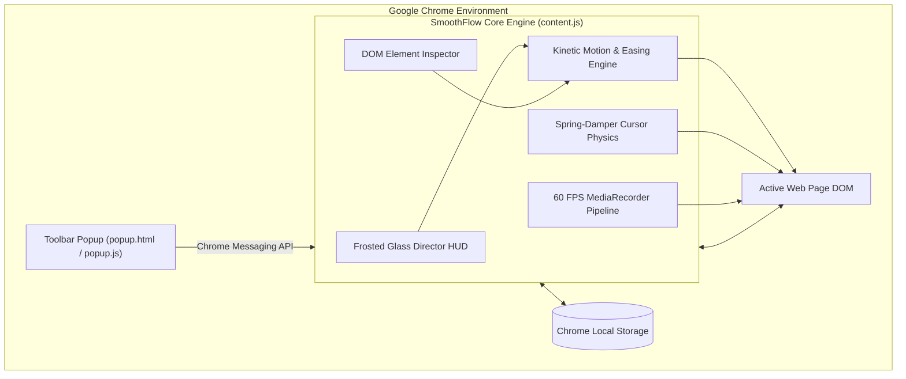

<div align="center">


# SmoothFlow Studio
### ⚡ Cinematic Web Scroll Director & 60 FPS Cursor Capture for Google Chrome

[](manifest.json)
[](#-chrome-web-store-publishing)
[](#-synchronized-60-fps--4k-recording)
[](#-synchronized-60-fps--4k-recording)
[](https://github.com/sponsors/earondemands-sys)
[](https://buymeacoffee.com/earondemands)
[](#-privacy--security)
[](LICENSE)

<br/>

**Transform jerky, amateur website recordings into buttery-smooth, cinematic product demos (Screen Studio style) directly inside your browser — zero video editing software required.**

[Features](#-key-features) • [Installation](#-installation-guide) • [Architecture](#-architecture) • [Keyboard Shortcuts](#-keyboard-shortcuts) • [Publishing](#-chrome-web-store-publishing) • [Contributing](#-contributing)

</div>

---

## 🌟 Why SmoothFlow?

Recording web applications usually means dealing with jagged mouse wheel clicks, erratic cursor jitters, and inconsistent manual pacing. Fixing this in post-production with After Effects or Premiere takes hours of tedious keyframing.

**SmoothFlow Studio solves this natively in Chrome.** Direct smooth camera crane movements, lock in section-to-section timing, smooth your mouse with spring-damper physics, and record crystal-clear 60 FPS videos with a single click.

```mermaid
flowchart LR
    subgraph OldWay["❌ The Pain (Manual Recording)"]
        direction TB
        A1["🖱️ Jerky Mouse Wheel Notches"]
        A2["🖐️ Erratic Cursor Twitches & Jitters"]
        A3["⏳ Hours of Tedious Post-Editing"]
    end

    subgraph Studio["⚡ SmoothFlow Studio Engine"]
        direction TB
        B1["🌊 Inertial Butter Momentum"]
        B2["🎯 Section-to-Section Waypoint Flight"]
        B3["🪄 Spring-Damper Cursor Physics"]
        B4["🎥 Synchronized 60 FPS Recorder"]
    end

    subgraph Output["✨ Studio-Grade Result (Screen Studio Style)"]
        direction TB
        C1["🎬 Cinematic Quintic Bezier Glide"]
        C2["🎯 Weighted, Fluid Cursor Motion"]
        C3["💎 Crisp 60 FPS / 4K Video Export"]
    end

    OldWay ==>|"Zero Post-Production"| Studio
    Studio ==>|"1-Click Instant Export"| Output
```



---

## ✨ Key Features

### 1. 🎯 Target Section Selector & Timeline Director
- **Click-to-Pick**: Hover and click any DOM element on the page (e.g. Hero title, pricing table, or CTA button) to lock in exact pixel coordinates.
- **"📌 Here" Shortcut**: Scroll to any desired viewpoint and capture coordinates instantly.
- **Smart Presets**: One-click flight paths for `Hero ➔ CTA`, `Hero ➔ Middle`, and `Hero ➔ Bottom`.
- **Multi-Scene Director**: Chain multiple scroll waypoints together with customized pause durations at each destination.

### 2. ⏱️ Camera Crane Easing Curves & Timing
Choose mathematically tuned motion profiles to fit the vibe of your product demo:

| Easing Profile | Motion Characteristics | Best Used For |
| :--- | :--- | :--- |
| **Cinematic Butter** | Smooth quintic polynomial ($t^5$) with soft deceleration | Hero showcases & landing page walk-throughs |
| **Ease-In-Out** | Balanced cubic acceleration curve | Standard interface navigation |
| **Cushioned Glide** | Linear acceleration with soft magnetic landing | Long documentation or multi-section reads |
| **Cruise** | Constant linear velocity with smooth buffer ramps | Triggering scroll-linked CSS animations |
| **Snappy** | Fast quadratic response with short damp | SaaS dashboards & high-density apps |
| **Spring Damped** | Mechanical harmonic oscillation | Playful, interactive UI elements |

### 3. 🎥 Synchronized 60 FPS & 4K Recording
- **1-Click Sync Record**: Coordinates countdown, HUD auto-hiding, scroll motion, and video capture automatically.
- **Clean Output**: The floating director HUD automatically disappears during recording so your output is 100% pristine.
- **High-Fidelity Codecs**: Native browser `MediaRecorder` supporting **WebM (VP9)** and **MP4 (H.264)** formats.
- **Resolution Scaler**: Capture at 720p, 1080p, 1440p 2K, and 2160p 4K UHD.
- **Instant Preview & Download**: Inspect your recording in the built-in video player modal and download immediately.

### 4. 🖱️ Screen Studio Virtual Cursor Physics
- **Spring-Damper Interpolation**: Replaces erratic hand twitches with clean, weighted gliding motion.
- **5 Sleek Cursor Styles**: `Arrow`, `Classic`, `Dot`, `Ring`, and `Halo`.
- **Luminance Adaptive Contrast**: Automatic high-contrast borders ensure the cursor never gets lost on dark or light backgrounds.
- **Click Wave Ripples**: Pulsing radial wave animations on mouse clicks.
- **Spotlight Mode**: Dynamically dims the background around the cursor to guide viewer focus.
- **Idle Auto-Hide**: Fades out seamlessly when motionless to keep reading unobstructed.

### 5. 🌊 Butter Wheel Inertial Scrolling
- Hooks into browser wheel events to convert harsh mouse wheel ticks into fluid, inertial momentum.

---

## ⌨️ Keyboard Shortcuts

Designed for high-speed workflow without interrupting your screen recordings:

| Action | macOS Shortcut | Windows / Linux Shortcut |
| :--- | :---: | :---: |
| **Toggle Floating HUD** | <kbd>⌘</kbd> + <kbd>Shift</kbd> + <kbd>E</kbd> | <kbd>Ctrl</kbd> + <kbd>Shift</kbd> + <kbd>E</kbd> |
| **Preview Motion Flight** | <kbd>⌘</kbd> + <kbd>Shift</kbd> + <kbd>S</kbd> | <kbd>Ctrl</kbd> + <kbd>Shift</kbd> + <kbd>S</kbd> |
| **Synchronized Record & Scroll** | <kbd>⌘</kbd> + <kbd>Shift</kbd> + <kbd>L</kbd> | <kbd>Ctrl</kbd> + <kbd>Shift</kbd> + <kbd>L</kbd> |
| **Abort / Stop Motion** | <kbd>Esc</kbd> | <kbd>Esc</kbd> |

---

## 🏗️ Architecture

SmoothFlow runs in a non-intrusive, isolated runtime injected via Chrome's Manifest V3 Content Script framework:



---

## 🚀 Installation Guide

### Option A: Install from Unpacked Source (Developers)

1. Clone or download this repository:
   ```bash
   git clone https://github.com/earondemands-sys/smoothflow.git
   cd smoothflow
   ```
2. Open Google Chrome and navigate to:
   ```
   chrome://extensions
   ```
3. In the top-right corner, switch the **Developer mode** toggle to **ON**.
4. In the top-left corner, click **Load unpacked**.
5. Select the `smoothflow` repository folder.
6. The **SmoothFlow Studio** icon will now appear in your browser toolbar!

---

### Option B: Built-in Interactive Demo

Test all features instantly without deploying a web server:

1. Open `demo.html` in Chrome:
   ```
   file:///path/to/smoothflow/demo.html
   ```
2. The sleek floating HUD will appear automatically.
3. Click the **Hero ➔ CTA** preset or use **🎯 Pick** to select elements.
4. Hit **Preview** (<kbd>⌘⇧S</kbd>) to witness the camera crane glide!
5. Hit **Record** (<kbd>⌘⇧L</kbd>) to export a crisp 60 FPS video.

---

## 📦 Developer Scripts & Production Packaging

SmoothFlow features a lightweight, zero-dependency Node.js toolchain for validation and distribution:

```bash
# 1. Run pre-flight linting, manifest verification, and syntax checks
npm run validate

# 2. Build store-ready release archive (dist/smoothflow-v1.0.0.zip)
npm run build

# 3. Run test suite
npm test
```

### Generated Artifacts
Running `npm run build` generates a pristine, stripped ZIP archive in `dist/` containing only store-essential files (`manifest.json`, `icons/`, `content/`, and `popup/`), automatically omitting `.DS_Store` and development files.

---

## 🛒 Chrome Web Store Publishing

To publish your own version to the Chrome Web Store:

1. Run `npm run build` to generate `dist/smoothflow-v1.0.0.zip`.
2. Visit the **[Chrome Web Store Developer Dashboard](https://chrome.google.com/webstore/devconsole)**.
3. Click **+ New Item** and upload `dist/smoothflow-v1.0.0.zip`.
4. Fill in the store details (icons are located in `icons/`).
5. Submit for automated review!

---

## 🔒 Privacy & Security

SmoothFlow is designed with privacy as a foundational principle:

- **100% Client-Side**: All video recording, scroll interpolation, and cursor simulation happens completely inside your local browser instance.
- **Zero Telemetry**: No analytics, tracking pixels, or external API calls.
- **Zero Third-Party Network Requests**: Works completely offline.
- **No Keystroke Logging**: Only designated hotkeys (`⌘⇧E`, `⌘⇧S`, `⌘⇧L`, `Esc`) are monitored.

---

## 🤝 Contributing

Contributions, feature requests, and bug reports are warmly welcome!
Please check out [CONTRIBUTING.md](CONTRIBUTING.md) for details on our code style and PR guidelines.

## 💖 Support the Project

If SmoothFlow helped you record buttery-smooth product demos or saved you hours in video editing, consider supporting ongoing development:

- **GitHub Sponsors**: [Sponsor @earondemands-sys on GitHub](https://github.com/sponsors/earondemands-sys) *(0% fee, 100% directly supports development)*
- **Buy Me a Coffee**: [buymeacoffee.com/earondemands](https://buymeacoffee.com/earondemands)

---

## 📄 License

This project is licensed under the **MIT License** — see the [LICENSE](LICENSE) file for details.

Developed with ❤️ by **[Jayakrishna Chinta](https://github.com/earondemands-sys)**.
