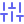
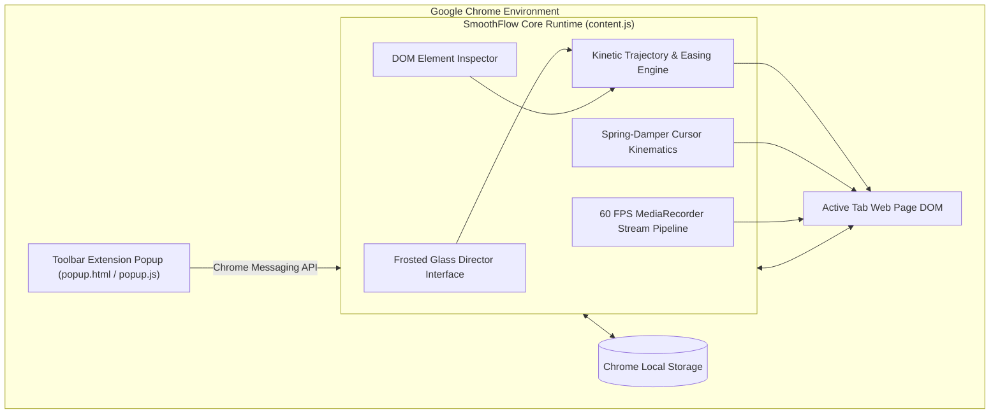
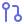

<div align="center">


# SmoothFlow Studio
### Cinematic Web Scroll Director & 60 FPS Cursor Capture for Google Chrome

[](manifest.json)
[](#chrome-web-store-publishing)
[](#synchronized-60-fps--4k-recording)
[](#synchronized-60-fps--4k-recording)
[](https://github.com/sponsors/earondemands-sys)
[](https://buymeacoffee.com/jaykrishna7)
[](#privacy--security)
[](LICENSE)

<br/>

**Transform jerky, manual web recordings into professional, cinematic product demos (Screen Studio quality) directly inside Google Chrome without external video editing suites.**

[Features](#key-features) • [Architecture](#architecture) • [Keyboard Shortcuts](#keyboard-shortcuts) • [Installation](#installation-guide) • [Sponsors](#sponsors--community-backing) • [Contributing](#contributing)

</div>

---

##  Why SmoothFlow?

Capturing web applications traditionally introduces mechanical mouse wheel notches, erratic pointer jitter, and inconsistent manual scroll pacing. Eliminating these flaws in post-production using timeline keyframing in Adobe After Effects or Premiere Pro requires substantial time and effort.

**SmoothFlow Studio automates camera crane dynamics natively within the browser runtime.** Direct multi-waypoint transitions, configure section-to-section timing, apply spring-damper cursor physics, and capture hardware-accelerated 60 FPS video with a single shortcut.

```mermaid
flowchart LR
    subgraph Input["Manual Screen Recording"]
        direction TB
        A1["Mechanical Scroll Wheel Notches"]
        A2["Pointer Jitter & Hand Tremors"]
        A3["Tedious Post-Production Keyframing"]
    end

    subgraph Core["SmoothFlow Runtime Engine"]
        direction TB
        B1["Inertial Momentum Filter"]
        B2["Waypoint Trajectory Planner"]
        B3["Spring-Damper Cursor Kinematics"]
        B4["Hardware-Accelerated 60 FPS Capture"]
    end

    subgraph Output["Production Master Output"]
        direction TB
        C1["Quintic Bezier Velocity Profile"]
        C2["Jitter-Free Weighted Pointer"]
        C3["Lossless 4K / 60 FPS Video Export"]
    end

    Input ==>|"In-Browser Interception"| Core
    Core ==>|"1-Click Pipeline"| Output
```



---

##  Key Features

###  1. Section Waypoint Selector & Timeline Director
- **Click-to-Pick Target Engine**: Hover and click any DOM node (Hero banners, pricing cards, call-to-action buttons) to lock in exact viewport coordinates.
- **Viewport Anchor Shortcut**: Instantly capture the current viewport scroll offset with the "Here" shortcut.
- **Preconfigured Flight Paths**: One-click navigation routines for `Hero -> CTA`, `Hero -> Middle`, and `Hero -> Bottom`.
- **Multi-Scene Director**: Chain sequential scroll destinations with custom pause durations at each waypoint.

###  2. Camera Crane Easing Curves & Velocity Profiles
Configure mathematically tuned easing functions to match your production style:

| Easing Profile | Velocity Characteristics | Primary Use Case |
| :--- | :--- | :--- |
| **Cinematic Quintic** | Symmetrical quintic polynomial ($t^5$) with soft deceleration | Hero showcases and landing page presentations |
| **Cubic Ease-In-Out** | Balanced cubic acceleration and braking curve | Standard user interface navigation |
| **Cushioned Glide** | Linear acceleration with magnetic soft landing | Documentation, blogs, and multi-paragraph reading |
| **Cruise** | Constant linear velocity with smooth buffer ramps | Triggering scroll-linked CSS and WebGL animations |
| **Snappy** | Quadratic curve with rapid initial acceleration | SaaS dashboards and dense technical interfaces |
| **Spring Damped** | Harmonic mechanical oscillation | Interactive component demonstrations |

###  3. Synchronized 60 FPS & 4K Video Recorder
- **Integrated Capture Pipeline**: Coordinates visual countdown, HUD auto-hiding, scroll execution, and capture triggers.
- **Zero-Artifact Output**: The floating director HUD automatically unmounts during capture to ensure 100% clean video frames.
- **High-Fidelity Codecs**: Native browser `MediaRecorder` supporting **WebM (VP9)** and **MP4 (H.264)** formats.
- **Resolution Scaler**: Output presets ranging from 720p HD up to 2160p 4K UHD.
- **Integrated Video Inspector**: Preview recordings in an embedded player with immediate local download.

###  4. Virtual Cursor Kinematics & Visual Physics
- **Spring-Damper Smoothing**: Eliminates erratic mouse movements through spring-damper differential equations.
- **5 Pointer Geometries**: Choose from `Arrow`, `Classic`, `Dot`, `Ring`, and `Halo`.
- **Luminance Adaptive Contrast**: Automatic contrast borders guarantee cursor visibility on dark and light surfaces.
- **Radial Click Ripples**: High-visibility radial wave pulses rendered on pointer clicks.
- **Spotlight Mode**: Dynamically dims surrounding interface elements to guide audience focus.
- **Activity-Aware Auto-Hide**: Fades out cursor during idle periods to prevent content obstruction.

###  5. Inertial Wheel Scroll Engine
- Intercepts native wheel events and applies inertia dampening to convert discrete wheel notches into fluid continuous motion.

---

##  Keyboard Shortcuts

Configured for high-efficiency operation without contaminating screen recordings:

| Command | macOS Shortcut | Windows / Linux Shortcut |
| :--- | :---: | :---: |
| **Toggle Floating HUD** | <kbd>⌘</kbd> + <kbd>Shift</kbd> + <kbd>E</kbd> | <kbd>Ctrl</kbd> + <kbd>Shift</kbd> + <kbd>E</kbd> |
| **Preview Motion Flight** | <kbd>⌘</kbd> + <kbd>Shift</kbd> + <kbd>S</kbd> | <kbd>Ctrl</kbd> + <kbd>Shift</kbd> + <kbd>S</kbd> |
| **Synchronized Record & Scroll** | <kbd>⌘</kbd> + <kbd>Shift</kbd> + <kbd>L</kbd> | <kbd>Ctrl</kbd> + <kbd>Shift</kbd> + <kbd>L</kbd> |
| **Cancel Operation / Abort** | <kbd>Esc</kbd> | <kbd>Esc</kbd> |

---

##  Architecture

SmoothFlow operates inside an isolated, non-intrusive runtime utilizing Chrome's Manifest V3 architecture:



---

##  Installation Guide

### Option A: Install from Source (Developer Mode)

1. Clone this repository locally:
   ```bash
   git clone https://github.com/earondemands-sys/smoothflow.git
   cd smoothflow
   ```
2. Open Google Chrome and enter:
   ```
   chrome://extensions
   ```
3. Enable the **Developer mode** toggle located in the upper-right corner.
4. Click **Load unpacked** in the upper-left corner.
5. Select the cloned repository directory.
6. The **SmoothFlow Studio** icon is now installed in your Chrome extensions menu.

---

### Option B: Local Interactive Demo

Test and verify all features locally without spinning up a server:

1. Open `demo.html` in Chrome:
   ```
   file:///path/to/smoothflow/demo.html
   ```
2. The director HUD mounts automatically.
3. Click the **Hero -> CTA** preset or use the **Pick** tool to select elements.
4. Press <kbd>⌘⇧S</kbd> (<kbd>Ctrl+Shift+S</kbd>) to preview camera flight.
5. Press <kbd>⌘⇧L</kbd> (<kbd>Ctrl+Shift+L</kbd>) to record a 60 FPS video.

---

##  Developer Toolchain & Production Packaging

SmoothFlow maintains a zero-dependency Node.js toolchain for automated validation and distribution:

```bash
# 1. Run manifest verification, asset integrity checks, and JS syntax validation
npm run validate

# 2. Package clean production archive into dist/smoothflow-v1.0.0.zip
npm run build

# 3. Execute testing pipeline
npm test
```

### Build Artifacts
Executing `npm run build` compiles a release-ready archive in `dist/` containing strictly required assets (`manifest.json`, `icons/`, `content/`, and `popup/`), automatically stripping system files and development overhead.

---

##  Chrome Web Store Publishing

To distribute your customized build:

1. Execute `npm run build` to generate `dist/smoothflow-v1.0.0.zip`.
2. Navigate to the **[Chrome Web Store Developer Dashboard](https://chrome.google.com/webstore/devconsole)**.
3. Select **+ New Item** and submit `dist/smoothflow-v1.0.0.zip`.
4. Populate listing metadata and submit for automated review.

---

##  Privacy & Security

SmoothFlow is engineered with strict local-first privacy guarantees:

- **100% Client-Side Execution**: All video capture, motion calculation, and cursor rendering occurs solely within your local browser session.
- **Zero Telemetry**: No tracking identifiers, analytics scripts, or diagnostic pings.
- **Zero External Network Dependencies**: Operates completely in offline environments.
- **No Keystroke Monitoring**: Only reserved shortcut combinations (<kbd>⌘⇧E</kbd>, <kbd>⌘⇧S</kbd>, <kbd>⌘⇧L</kbd>, <kbd>Esc</kbd>) are observed.

---

##  Sponsors & Community Backing

SmoothFlow Studio is an independent open-source project. If SmoothFlow saves you hours in post-production video editing or elevates your product demos, consider supporting ongoing development.

<div align="center">

[](https://github.com/sponsors/earondemands-sys)
[](https://buymeacoffee.com/jaykrishna7)

</div>

### Sponsorship Benefits

100% of sponsorship funds directly support continuous engine maintenance, 4K/60fps encoder optimization, and new motion kinematics features.

| Backer Level | Contribution | Perks & Recognition |
| :--- | :--- | :--- |
| **Individual Backer** | Custom / One-Time | Permanent acknowledgment in GitHub Releases and README backers list |
| **Community Supporter** | $5 / month | Supporter badge + Early access to beta builds and design discussions |
| **Bronze Sponsor** | $25 / month | Personal / company logo and link displayed in the repository README |
| **Silver Sponsor** | $100 / month | Prominent logo placement on README + Priority issue and bug resolution |
| **Gold / Enterprise** | $250+ / month | Top-tier header logo + Custom feature request consultation |

- **Sponsor directly via GitHub (0% platform fee, 100% direct developer payout)**:  
  [https://github.com/sponsors/earondemands-sys](https://github.com/sponsors/earondemands-sys)

- **Sponsor via Buy Me a Coffee**:  
  [https://buymeacoffee.com/jaykrishna7](https://buymeacoffee.com/jaykrishna7)

---

##  Contributing

Contributions, technical discussions, and feature proposals are welcome.
Please review [CONTRIBUTING.md](CONTRIBUTING.md) for code styling and branch submission standards.

---

##  License

This project is licensed under the **MIT License** — see the [LICENSE](LICENSE) file for complete details.

Developed by **[Jayakrishna Chinta](https://github.com/earondemands-sys)**.
